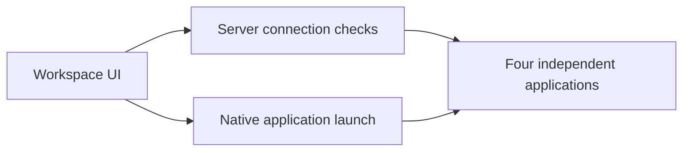

# Zenith Enterprise AI Workspace

## One portal, four application boundaries

**Shah Hussain Bangash · Dubai, UAE**  
**Scope:** Local Next.js workspace for launching independent enterprise AI applications and checking their configured endpoints.

### The architecture problem

A team exploring several AI products needs a single place to find them and tell whether each is reachable. A green health probe can easily be mistaken for working authentication or a completed business workflow. This workspace gives each project its own launch link, probe configuration and native access boundary.

### My engineering contribution

I built a server-side connection layer that reads administrator-provided addresses at runtime and reports distinct connection states to the portal. I separated reachability from authorization so a login page, redirect or unexpected response cannot be presented as a healthy service.



| Application | Role in the workspace |
| --- | --- |
| NAWA | Bilingual document intelligence. The default readiness probe expects its documented readiness response. |
| FinAgent Enterprise | AML investigation. The connector is disabled by default until configured. Launch-only mode can expose a native launch address without inventing a health route. |
| SupplyPilot AI | Procurement. Its configured health check and native sign-in remain distinct. |
| IndustrialAI Sentinel | Equipment monitoring. The portal defines a separate health route. The application and its data are maintained separately. |

### One connection check

In the test fixture, the same local service returned four representative responses. The connection layer classified expected health JSON as healthy, HTTP 401 as authentication required, an HTTP redirect as blocked, and an HTML login page as an invalid health response. The probe performs a bounded GET and does not forward browser credentials. The application still handles the user's native sign-in and permissions.

### What was verified

| Evidence | Result and scope |
| --- | --- |
| [Connection test suite](../../tests/integration-service.test.mjs) | Re-ran **14 tests with zero failures** on Node.js 24.22.3 using code from [`948d237`](https://github.com/shah-hussain-bangash/ENTERPRISE-AI-PRODUCTION-SYSTEMS/commit/948d237c7d033a3970ed94e89cd1c9e823dbeba8). The suite includes controlled loopback HTTP and injected responses. |
| [Recorded delivery verification](../VERIFICATION.md) | The 10 November 2026 delivery record documents a fresh installation, typecheck, production build and HTTP smoke tests against controlled fixtures. |
| [Connection implementation](../../lib/integration-service.mjs) and [access boundary](../../lib/workspace-access.mjs) | The source exposes the probe contract and the separation between local access and explicitly configured gateway access. |

From the repository root, run:

```bash
node --test tests/integration-service.test.mjs
```

### Next evidence to collect

The [integration contract](../INTEGRATION_CONTRACT.md) proposes a useful first business workflow: pass permitted, versioned NAWA quotation evidence to SupplyPilot and record independent approval against the exact proposal. That cross-application workflow, shared identity in production and live operational metrics remain open. The portfolio evidence today is connection verification and independent application boundaries.
